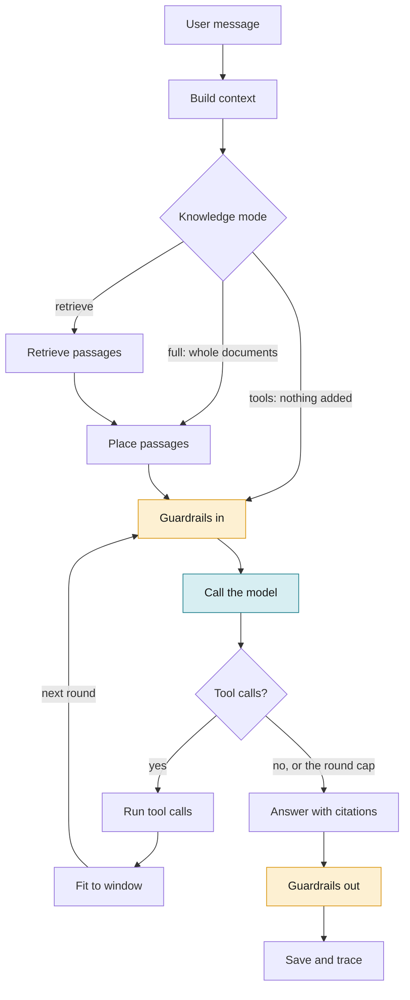
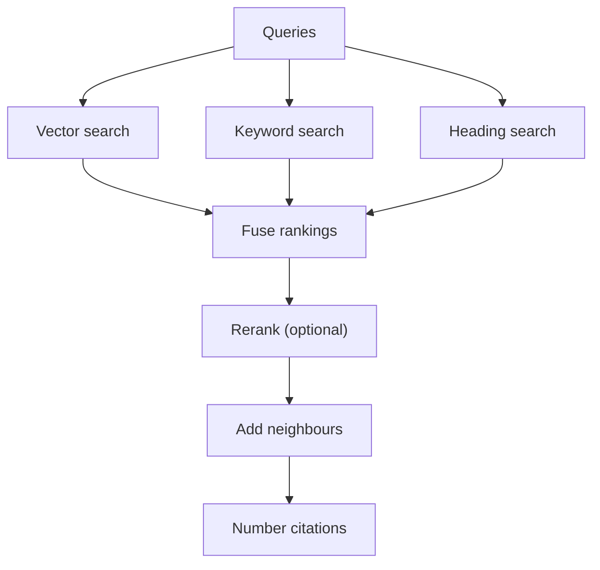
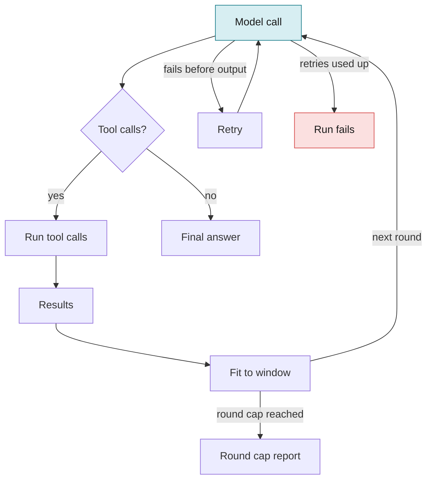

# How Kera answers

This page shows what Kera does between your question and its answer, and which settings steer each step. It is the same content as **Admin > Help** in the web app, drawn as diagrams that GitHub shows. Where a number is a default, your install may have changed it under Admin > Settings.

Kera answers in two stages. First it builds the prompt and, if the assistant has knowledge, searches it. Then it calls the model, runs the tools the model asks for, and calls the model again until it answers. Parts A and B follow the first stage, part C the second.

## A. How a question is answered

The guard wraps every call to a model, so "Guardrails in" runs again in each round of the loop, and "Guardrails out" checks the reply as it streams. The knowledge mode is an option of the assistant (Workspace > Models > Knowledge), not a setting.

### 1. The question arrives

- You send a message from the web app or the API. Kera finds the assistant (the model preset) you chose and saves your message and an empty reply.
- The run is detached from your browser. Closing the tab does not stop it.
- Hook servers, if you have any, can change the message first (inlet hooks) and the reply last (outlet hooks).

Hook servers are set in Settings > Hook servers.

When it misbehaves:

- Admin > Traces lists the run as soon as it finishes.

Read: [Run trace and prompt layout](run-trace.md)

### 2. Build the context

- Kera puts together what the model will read: the assistant’s system prompt (plus the task prompt for a Cowork task), a list of the attached files, and the earlier turns of the chat as text.
- An earlier reply that used tools carries a short digest of the steps it took. A hosted model gets the tool names only.
- When the chat is long, older turns are replaced by a summary (compaction between turns). The newest part of the chat stays as written.
- Memory is not copied into the prompt. The model reads it only when it calls a memory tool, and memory is off until an admin turns it on and the user opts in.

| Setting | Default | Where |
|---|---|---|
| `chat.compaction.enable` | `true` | Settings > Chat |
| `chat.compaction.threshold` | `120000` | Settings > Chat |
| `chat.compaction.retention` | `30` | Settings > Chat |
| `chat.context.digest` | `true` | Settings > Chat |
| `chat.memory.enable` | `false` | Settings > Chat |

chat.compaction.retention is the share of turns (in percent) kept as written. For a local model, or a model that declares its window, the threshold is 70% of the window instead of chat.compaction.threshold.

When it misbehaves:

- In Admin > Traces, a compaction step named summarise shows the turns summarised and the estimated tokens before and after.
- The first model step shows the messages and characters sent.

Read: [Context management inside a run](context-management.md)

### 3. Decide how to use knowledge

- Each knowledge collection of an assistant has a mode (Workspace > Models > Knowledge): relevant parts in the prompt (retrieve), the model searches with tools (tools), whole documents in the prompt (full), or automatic.
- Automatic means retrieve when a reranker works. Without one it means tools if the run has tool servers, and otherwise retrieve.
- Full puts whole documents in the prompt, up to a size limit.
- In tools mode nothing is added to the prompt. The model calls list_knowledge, search_knowledge_files, query_knowledge_files or view_knowledge_file when it decides to. These tools are offered in every mode when the assistant has knowledge.

| Setting | Default | Where |
|---|---|---|
| `rag.full_context_max_chars` | `400000` | Settings > Retrieval |
| `rag.reranker.url` | empty | Settings > Retrieval |

The mode itself is an option of the assistant, not a setting.

When it misbehaves:

- A run in retrieve or full mode has a retrieval step in Admin > Traces. A run in tools mode has none, and calls to query_knowledge_files show as tool steps.

Read: [How knowledge search works](retrieval.md)

### 4. Retrieve passages

- Retrieve mode searches the collections the user can read. The next section follows one question through every step with example numbers.
- The result is a short list of numbered passages, best first, at most rag.top_k_rerank of them before neighbours are added.

| Setting | Default | Where |
|---|---|---|
| `tasks.query` | `true` | Settings > Tasks |
| `rag.top_k` | `30` | Settings > Retrieval |
| `rag.top_k_rerank` | `8` | Settings > Retrieval |
| `rag.fuse_queries` | `true` | Settings > Retrieval |
| `rag.neighbors` | `1` | Settings > Retrieval |
| `rag.reranker.url` | empty | Settings > Retrieval |

When it misbehaves:

- Admin > Traces, retrieval step: collections searched, passages found, the top scores, and whether the search was reranked.
- A search that found nothing is marked as a warning in the waterfall.

Read: [How knowledge search works](retrieval.md)

### 5. Place the passages in the prompt

- With placement system, the numbered passages go inside the system prompt, with an instruction to cite by number and to say so when the sources lack the answer.
- With placement data, the system prompt keeps only the instructions. The passages become their own message just before your newest message, marked as untrusted reference material. They are built for each run and are not saved with the chat.
- Data placement keeps the system prompt the same from turn to turn, so providers that cache the start of a prompt can reuse it. The guardrails also check that message like tool output.

| Setting | Default | Where |
|---|---|---|
| `rag.placement` | `system` | Settings > Retrieval |
| `rag.template` | empty | Settings > Retrieval |

When it misbehaves:

- Compare the cached share of follow-up turns in Admin > Traces before and after switching.
- Guardrail events named injection.data count injection phrases found in a data message.

Read: [Run trace and prompt layout](run-trace.md)

### 6. Guardrails on the way in

- Every call to a model passes through the guard. It scans the messages and tool results that are about to be sent: personal data (log, redact or block), injection phrases, an admin blocklist, and optional moderation.
- It runs again before each later round, so tool results are scanned too. The system prompt is skipped. Local models are exempt by default.

| Setting | Default | Where |
|---|---|---|
| `guardrails.pii` | `log` | Settings > Guardrails |
| `guardrails.injection` | `log` | Settings > Guardrails |
| `guardrails.blocklist` | `[]` | Settings > Guardrails |
| `guardrails.moderation` | `off` | Settings > Guardrails |
| `guardrails.local_exempt` | `true` | Settings > Guardrails |

When it misbehaves:

- Settings > Guardrails > Recent events lists what the guard saw, by rule name and count. The matched text is never stored.
- A blocked call fails with the code guardrail_blocked.

Read: [Guardrails](../README.md#guardrails)

### 7. Call the model

- The model gets the messages and the definitions of every tool the run has, and streams its reply. It either answers or asks for tool calls.
- A call that fails before any output (429, a 5xx error, a connection error or a timeout) is repeated after 1 s and then 2 s. A failure after the first output is never repeated, because the text is already on screen.

| Setting | Default | Where |
|---|---|---|
| `chat.model_retries` | `2` | Settings > Chat |

When it misbehaves:

- Admin > Traces, model step: prompt, cached and completion tokens, stop reason, tools offered, and the attempt number of a retry.

Read: [Context management inside a run](context-management.md)

### 8. Run the tool calls

- Tools are built-in sets (web, knowledge, files, memory, code), tool servers (OpenAPI or MCP, the Model Context Protocol) and skills. A skill adds only its name and description to the prompt; its text loads when the model asks.
- The calls of one round run together, at most 4 at once, only when there are several and all belong to the web, knowledge or files sets. Any other tool makes the round run one call after another. Results keep the order of the calls.
- The same tool with the same arguments three times in a row is not run the third time. The model is told to try something else.
- A tool server cuts a result at its size cap and says so in the result.

| Setting | Default | Where |
|---|---|---|
| `chat.parallel_tools` | `true` | Settings > Chat |
| `chat.repeat_limit` | `3` | Settings > Chat |
| `tools.max_result_chars` | `100000` | Settings API; each tool server has its own |
| `web.search.max_calls_per_turn` | `3` | Settings > Web search |
| `web.fetch.max_calls_per_turn` | `3` | Settings > Web search |
| `cowork.web.max_searches` | `15` | Settings > Web search |
| `cowork.web.max_fetches` | `15` | Settings > Web search |

The web budgets of a chat reply are the two per-turn keys; a Cowork task uses cowork.web.max_searches and cowork.web.max_fetches.

When it misbehaves:

- Admin > Traces, tool steps: name, server, size of arguments and result, failed, truncated, and repeat_refused.
- A failed tool step is red; a truncated one is amber.

Read: [Context management inside a run](context-management.md)

### 9. Keep the prompt inside the window

- Right after a tool runs, a result longer than the spill size is stored as a file. The model gets the start, the end and the file name, and can read the rest with view_file. The file tools join a run automatically when it has other tools.
- Before each call, Kera estimates the prompt size. Above 70% of the window, the results of rounds older than the newest 4 are replaced by one line each, oldest first, down to 50%.
- If the prompt is still above 70%, the run so far is summarised by the task model and the summary replaces it. The newest 2 rounds stay.
- When a call reports 97% or more of the window, the trace records overflow_suspected. Ollama silently drops the oldest messages of a prompt that is too long, so this is the only sign.

| Setting | Default | Where |
|---|---|---|
| `chat.context.enable` | `true` | Settings > Chat |
| `chat.context.window_local` | `16000` | Settings > Chat |
| `chat.context.clear_at` | `0.7` | Settings > Chat |
| `chat.context.clear_to` | `0.5` | Settings > Chat |
| `chat.context.keep_rounds` | `4` | Settings > Chat |
| `chat.context.compact` | `true` | Settings > Chat |
| `tools.spill_chars` | `0` | Settings > Chat |

The window comes from the model parameter context_window, then num_ctx, then the setting: window_local for a local model, chat.compaction.threshold for a hosted one.

When it misbehaves:

- Admin > Traces, steps named spill, clear, summarise_run and overflow_suspected, with the tokens before and after.

Read: [Context management inside a run](context-management.md)

### 10. Answer with citations

- When the model answers without tool calls, the loop ends. At the round cap the model gets one more call without tools and a line asking for a final report, so a long task ends with a report instead of a status line.
- Passages are numbered once per run. The same passage keeps its number in the prompt and in later searches, so [3] means one passage everywhere. The web app turns [n] into a link to the sources list.

| Setting | Default | Where |
|---|---|---|
| `chat.max_tool_iterations` | `30` | Settings > Chat |
| `cowork.max_tool_iterations` | `100` | Config file (kera apply) |

When it misbehaves:

- Admin > Traces, last model step: stop reason stop, or round_cap when the cap was reached.

Read: [Context management inside a run](context-management.md)

### 11. Guardrails on the way out

- The reply is checked for personal data while it streams. It is off by default. With redact, a short tail of the stream is held back so that a value split across chunks is still caught.

| Setting | Default | Where |
|---|---|---|
| `guardrails.output_pii` | `off` | Settings > Guardrails |

When it misbehaves:

- Settings > Guardrails > Recent events, rules marked (reply).

Read: [Guardrails](../README.md#guardrails)

### 12. Saved and traced

- The reply is saved with the chat after each round and at the end. A usage row (tokens and time) is written. The steps of the run are written to the trace in one batch.
- Background tasks then run: a title, tags and follow-up suggestions. Every few user messages a memory review runs if memory is on.
- The audit log records what admins change (settings, secrets, users and so on). It does not record chat answers. What the guardrails did to model calls is in the guardrail events.

| Setting | Default | Where |
|---|---|---|
| `trace.enable` | `true` | Settings > Chat |
| `trace.retention_days` | `30` | Settings > Chat |
| `tasks.title` | `true` | Settings > Tasks |
| `tasks.tags` | `true` | Settings > Tasks |
| `tasks.follow_ups` | `true` | Settings > Tasks |
| `chat.memory.review_every` | `5` | Settings > Chat |
| `audit.retention_days` | `365` | Audit page |

When it misbehaves:

- Admin > Traces for the run, Admin > Audit for admin changes, Settings > Guardrails > Recent events for redaction.
- A trace holds sizes, counts and timings. It never holds prompts, answers, tool arguments or tool results.

Read: [Run trace and prompt layout](run-trace.md)

## B. The retrieval pipeline

Vector, keyword and heading search run side by side on every query. The rankings are fused in one step, an optional reranker re-reads the best candidates, neighbouring chunks are added, and the passages are numbered.

### 1. Write the queries

- On the first turn of a chat, the search uses your message as written.
- On later turns, the task model writes one to three keyword queries from the conversation, so a follow-up such as “and the second one?” still searches for something useful. The tool query_knowledge_files sends the model’s own query instead.
- Up to five queries are searched together. The reranker, when there is one, judges every passage against the first query.

| Setting | Default | Where |
|---|---|---|
| `tasks.query` | `true` | Settings > Tasks |

When it misbehaves:

- Queries are not stored in the trace. Admin > Traces shows the retrieval step that followed them.

Read: [How knowledge search works](retrieval.md)

### 2. Vector search

- An embedding model turns the query into a list of numbers. Kera returns the chunks whose numbers are nearest, which finds passages that say the same thing in other words.
- It keeps the best rag.top_k candidates (30).

| Setting | Default | Where |
|---|---|---|
| `rag.top_k` | `30` | Settings > Retrieval |
| `rag.embedding.model` | `nomic-embed-text` | Settings > Retrieval |
| `rag.embedding.query_prefix` | empty | Settings > Retrieval |

Changing the embedding model or its prefixes needs kera reindex (`none` as a prefix means no prefix; see docs/retrieval.md).

When it misbehaves:

- If an exact word is missing from the answer, check the keyword rank before blaming this step.

Read: [How knowledge search works](retrieval.md)

### 3. Keyword search

- Postgres full-text search over the text of each chunk, with the words of the query joined by OR. It finds exact words, codes and names that a vector search can miss.
- It keeps the best rag.top_k candidates (30). Its weight against vector search is rag.hybrid.bm25_weight.

| Setting | Default | Where |
|---|---|---|
| `rag.hybrid.bm25_weight` | `0.5` | Settings > Retrieval |
| `rag.top_k` | `30` | Settings > Retrieval |

The setting is named bm25, but the ranking is Postgres ts_rank_cd, not BM25.

When it misbehaves:

- The weight is a share from 0 to 1: keyword gets that share and vector gets the rest.

Read: [How knowledge search works](retrieval.md)

### 4. Heading and file name search

- A third keyword ranking looks at the file name and the heading path of each chunk (for example Returns > Time limit). A chunk can say the right thing under a heading that a short question names.
- Its weight is rag.hybrid.head_weight. Set it to 0 to switch it off.

| Setting | Default | Where |
|---|---|---|
| `rag.hybrid.head_weight` | `0.25` | Settings > Retrieval |

Chunks indexed before this existed have no heading row until you run kera reindex --heads.

When it misbehaves:

- New and re-indexed files get heading rows when they are indexed.

Read: [How knowledge search works](retrieval.md)

### 5. Fuse the rankings

- Reciprocal rank fusion (RRF) gives each passage a score from each list it appears in: weight / (60 + rank). The scores are added. A passage that is second in two lists beats one that is first in only one.
- With rag.fuse_queries on, the lists of all queries go into one fusion. Off, each query is searched alone and the results are joined.
- The best rag.top_k fused passages go on.

| Setting | Default | Where |
|---|---|---|
| `rag.fuse_queries` | `true` | Settings > Retrieval |
| `rag.hybrid.bm25_weight` | `0.5` | Settings > Retrieval |
| `rag.hybrid.head_weight` | `0.25` | Settings > Retrieval |
| `rag.top_k` | `30` | Settings > Retrieval |

Vector weight is 1 minus rag.hybrid.bm25_weight. The heading weight is added on top, not taken from the other two. The constant 60 is fixed.

When it misbehaves:

- Admin > Traces, retrieval step: the top scores. Without a reranker these are fusion scores, which are small numbers by design.

Read: [How knowledge search works](retrieval.md)

### 6. Rerank (optional)

- When a reranker is configured, it reads the first query and each candidate together and gives a relevance score. That is a closer reading than adding up ranks.
- Passages below rag.relevance_threshold are dropped, but never below rag.min_results. A threshold ranks and never empties the answer. The best rag.top_k_rerank are kept. The default threshold is 0, which keeps all.
- Runs on a local model do not send passages to an external reranker unless rag.reranker.local_runs is allow. They can use rag.reranker.local_url.
- If the reranker fails, Kera uses the fused order for 5 minutes. Without a reranker, the best rag.top_k_rerank of the fused list are kept.

| Setting | Default | Where |
|---|---|---|
| `rag.reranker.url` | empty | Settings > Retrieval |
| `rag.reranker.local_url` | empty | Settings > Retrieval |
| `rag.reranker.local_runs` | `skip` | Settings > Retrieval |
| `rag.relevance_threshold` | `0` | Settings > Retrieval |
| `rag.min_results` | `3` | Settings > Retrieval |
| `rag.top_k_rerank` | `8` | Settings > Retrieval |

When it misbehaves:

- Admin > Traces, retrieval step: reranked yes or no.
- A reranker adds time to every search; the waterfall shows how much.

Read: [How knowledge search works](retrieval.md)

### 7. Add the neighbouring chunks

- A chunk is a cut of about 1,000 characters. Kera adds the rag.neighbors chunks before and after each kept chunk from the same file, so the model reads the passage, not a fragment.
- Chunks that touch are joined into one passage, and the overlap two chunks share is written once. A passage is cut at rag.passage_max_chars. Files come in the order of their best hit, and the passages of a file in document order.
- rag.neighbors set to 0 returns the lone chunk.

| Setting | Default | Where |
|---|---|---|
| `rag.neighbors` | `1` | Settings > Retrieval |
| `rag.passage_max_chars` | `3000` | Settings > Retrieval |

When it misbehaves:

- A larger neighbour count makes the prompt bigger. Check the prompt tokens of the first model step.

Read: [How knowledge search works](retrieval.md)

### 8. Number the passages

- Each passage gets a citation number. The passages in the prompt and the results of every later search share one numbering, so [3] is the same passage wherever the model read it and in the sources list of the answer.
- A passage found again by a later search keeps its number.

When it misbehaves:

- In the answer, click a number to open its source.

Read: [How knowledge search works](retrieval.md)

### A worked example

The numbers below are **illustrative**: the passages and their ranks are invented. Only the arithmetic is real. The question is "How many days do I have to return an item?", and the collection has five passages that could matter. The weights are the defaults: vector 0.5 (one minus `rag.hybrid.bm25_weight`), keyword 0.5, heading 0.25.

| Passage | Where | Vector rank | Keyword rank | Heading rank | Fused score |
|---|---|---|---|---|---|
| A: "You can return an item within 30 days of delivery." | returns.md, Returns > Time limit, chunk 4 | 2 | 3 | 1 | 0.0201 |
| B: "Delivery takes 3 to 5 days." | shipping.md, Shipping > Delivery times, chunk 1 | 3 | 1 | none | 0.0161 |
| C: "Refunds are paid within 10 days after we get the item back." | returns.md, Returns > Refunds, chunk 8 | 1 | 2 | 3 | 0.0202 |
| D: "Items carry a 12 month warranty." | warranty.md, Warranty, chunk 7 | 5 | none | none | 0.0077 |
| E: "Sale items cannot be returned." | terms.md, Terms > Exceptions, chunk 2 | 4 | none | 2 | 0.0118 |

1. **Fuse.** Each score is weight / (60 + rank), added over the lists. For A: 0.5/(60+2) + 0.5/(60+3) + 0.25/(60+1) = 0.0201. For C: 0.5/(60+1) + 0.5/(60+2) + 0.25/(60+3) = 0.0202. The fused order is C, A, B, E, D. C leads by a hair because it is first for meaning, although A answers the question.
2. **Rerank.** A reranker reads the question with each passage and gives a score: A 0.92, C 0.41, E 0.30, B 0.12, D 0.03. A is now first. With an example threshold of 0.5 only A clears it, but `rag.min_results` (3) keeps the next two, so the kept passages are A, C and E. The default threshold is 0, which keeps everything up to `rag.top_k_rerank`.
3. **Neighbours.** With `rag.neighbors` at 1, each kept chunk is widened by one chunk on each side: A becomes chunks 3 to 5 of returns.md, C chunks 7 to 9, E chunks 1 to 3 of terms.md. They do not touch, so they stay three passages. Chunks that touch would be joined into one.
4. **Number.** Files come in the order of their best hit, and the passages of a file in document order: [1] returns.md chunks 3 to 5, [2] returns.md chunks 7 to 9, [3] terms.md chunks 1 to 3. The model cites them as [1], [2] and [3], and the sources list of the answer uses the same numbers.

## C. The agent loop

One round is one pass through "Model call", "Run tool calls", "Results" and "Fit to window". The loop ends with an answer, at the round cap, or on an error. A failed call that produced no output is tried again first.

### 1. Model call

- One round starts with a call to the model with the system prompt, the turns, any retrieved passages, the tool definitions and everything the earlier rounds added.
- Before the call, Kera fits the prompt to the window (see the meter below). Every call also goes through the guardrails.

| Setting | Default | Where |
|---|---|---|
| `chat.max_tool_iterations` | `30` | Settings > Chat |
| `cowork.max_tool_iterations` | `100` | Config file (kera apply) |

When it misbehaves:

- Admin > Traces, model steps, one per round.

Read: [Context management inside a run](context-management.md)

### 2. Run the tool calls

- The calls the model asked for are run. Up to 4 read-only calls (web, knowledge, files) run at once. Others run one after another.
- An unknown tool name or a failed tool comes back to the model as an error text, so the model can try again or change course.
- The repeat guard refuses the third identical call in a row.

| Setting | Default | Where |
|---|---|---|
| `chat.parallel_tools` | `true` | Settings > Chat |
| `chat.repeat_limit` | `3` | Settings > Chat |

When it misbehaves:

- Tool steps with is_error or repeat_refused in Admin > Traces.

Read: [Context management inside a run](context-management.md)

### 3. Results go back

- Each result is added to the conversation as a tool message. A result longer than the spill size is stored as a file and the model sees its start, its end and the file name.
- A tool server cuts any result at its own size cap.

| Setting | Default | Where |
|---|---|---|
| `tools.spill_chars` | `0` | Settings > Chat |
| `tools.max_result_chars` | `100000` | Settings API; each tool server has its own |

When it misbehaves:

- A spill step and the truncated flag of a tool step in Admin > Traces.

Read: [Context management inside a run](context-management.md)

### 4. Fit the prompt to the window

- Before the next call: above clear_at of the window, old results are cleared down to clear_to. If the prompt is still above clear_at, the run so far is summarised. The system prompt, earlier turns and your request are never touched.
- A cleared result keeps its message, so every tool call still has an answer. If the summary call fails, the run goes on and clears harder.

| Setting | Default | Where |
|---|---|---|
| `chat.context.enable` | `true` | Settings > Chat |
| `chat.context.clear_at` | `0.7` | Settings > Chat |
| `chat.context.clear_to` | `0.5` | Settings > Chat |
| `chat.context.keep_rounds` | `4` | Settings > Chat |
| `chat.context.compact` | `true` | Settings > Chat |

When it misbehaves:

- Steps named clear and summarise_run in Admin > Traces.

Read: [Context management inside a run](context-management.md)

### 5. Retry a failed call

- A model call that fails before any output, with a 429, a 5xx error, a connection error or a timeout, is repeated up to chat.model_retries times, after 1 s and then 2 s.
- Each try is its own model step in the trace. A failure after the first output is not repeated.

| Setting | Default | Where |
|---|---|---|
| `chat.model_retries` | `2` | Settings > Chat |

When it misbehaves:

- Model steps with an attempt number, and will_retry on the one that failed.

Read: [Context management inside a run](context-management.md)

### 6. Final answer

- A round with no tool calls ends the loop. The reply is the answer, with its citations.

When it misbehaves:

- The last model step has stop reason stop.

Read: [Context management inside a run](context-management.md)

### 7. Round cap, then a final report

- At chat.max_tool_iterations rounds (30 in a chat, 100 in a task) the model gets one more call, without tools, with a line asking it to write what was done, what was found and what is still open.
- If that call fails, the run still ends normally and keeps the work that was saved.

| Setting | Default | Where |
|---|---|---|
| `chat.max_tool_iterations` | `30` | Settings > Chat |
| `cowork.max_tool_iterations` | `100` | Config file (kera apply) |

When it misbehaves:

- The last model step has stop reason round_cap and the flag final_report.

Read: [Context management inside a run](context-management.md)

### 8. Error

- When the retries are used up, or a failure comes after output began, the run ends with an error code (for example provider_error or timeout). The work saved so far stays in the chat.
- A trace step stores the short code and the HTTP status, never the server’s message.

| Setting | Default | Where |
|---|---|---|
| `chat.model_retries` | `2` | Settings > Chat |

When it misbehaves:

- A red model step in Admin > Traces.

Read: [Run trace and prompt layout](run-trace.md)

### The window meter

The loop estimates the prompt size before each call: the size the server reported for the last call, plus an estimate (characters divided by 4) for what was added since. It compares that with the window. With the default settings:

| Window | Local model, no declared window | Hosted model, no declared window |
|---|---|---|
| Window in tokens (`chat.context.window_local` or `chat.compaction.threshold`) | 16,000 | 120,000 |
| Nothing happens up to 70% (`chat.context.clear_at`) | 11,200 | 84,000 |
| Old results cleared down to 50% (`chat.context.clear_to`) | 8,000 | 60,000 |
| Overflow suspected from 97% (fixed in the code) | 15,520 | 116,400 |
| A result longer than this many characters is spilled to a file (`tools.spill_chars` 0: one eighth of the window, at least 8,000) | 8,000 | 60,000 |

If the model declares its window (the model parameter `context_window`, or `num_ctx`), that number is used instead. Above the clear mark, results of rounds older than the newest 4 are cleared, oldest first. If the prompt is still above the mark, the run so far is summarised and the newest 2 rounds stay. Admin > Help has a slider that shows the same thresholds.

## D. What to tune and what to measure

Start from the symptom. Look at the trace first, change one setting, and compare on the same questions.

| Symptom | Look at | Settings to try | Measure |
|---|---|---|---|
| The answer misses a fact that is in the documents | Admin > Traces, retrieval step: how many passages were found, the top scores, and whether the search was reranked. Then read the sources under the answer. | `rag.top_k_rerank`, `rag.neighbors`, `rag.hybrid.head_weight`, `rag.fuse_queries`, `rag.reranker.url`, `rag.min_results` | Keep questions with the facts a good answer must hold. Compare the share of facts found in the top 5, 10 and 30 passages before and after one change (docs/retrieval.md). |
| The answer invents a code, a name or a number | Admin > Traces: a retrieval step with 0 passages is a warning. Check the assistant’s knowledge mode and whether the passage is in the sources list at all. | `rag.hybrid.bm25_weight`, `rag.hybrid.head_weight`, `rag.template`, `rag.reranker.url` | Ask the same questions before and after the change. Differences smaller than the spread between two identical runs are noise (docs/retrieval.md). |
| It is slow | Admin > Traces waterfall: which step is long. A reranker, many rounds, a slow tool or retries each look different. | `rag.top_k`, `rag.neighbors`, `chat.parallel_tools`, `chat.model_retries`, `chat.max_tool_iterations` | Run time and the time of each step in the trace. Compare runs of similar questions. |
| The prompt is too big, or the model forgets the start | Admin > Traces: prompt tokens per round, steps named clear, summarise_run and overflow_suspected, and the tools offered. | `chat.context.window_local`, `chat.context.clear_at`, `tools.spill_chars`, `rag.top_k_rerank`, `rag.passage_max_chars`, `tools.max_result_chars` | Largest prompt per round before and after a change; how often a run needed clearing (docs/context-management.md). |
| A long task stalls, loops or stops early | Admin > Traces: number of rounds, a last model step with stop reason round_cap, tool steps with repeat_refused, and model steps that were retried. | `chat.max_tool_iterations`, `cowork.max_tool_iterations`, `chat.repeat_limit`, `chat.model_retries`, `chat.context.compact`, `chat.context.keep_rounds` | How many runs end at the cap and how many calls were retried (docs/context-management.md). |
| Follow-up turns cost as much as the first | Admin > Traces: the cached share of the prompt on later turns. Providers cache the start of a prompt, and passages inside the system prompt change it. | `rag.placement` | Cached share of follow-up turns under each placement, and the quality of answers on your own questions (docs/run-trace.md). |

This repository has no built-in evaluation screen. The way to measure a retrieval change on your own questions is in [retrieval.md](retrieval.md#checking-a-change-on-your-own-questions), and the questions to ask of the trace are in [context-management.md](context-management.md#what-the-trace-shows).

## E. Read more

- [How Kera answers](how-it-answers.md): This page as animated diagrams, for reading on GitHub.
- [How knowledge search works](retrieval.md): The ranking steps, their settings, what an upgrade needs, and how to check a change on your own questions.
- [Context management inside a run](context-management.md): Window tracking, spilling, clearing, mid-run summaries, retries, the round cap and the repeat guard.
- [Run trace and prompt layout](run-trace.md): What each step of a trace records, and where retrieved passages go in the prompt.
- [Audit log](audit.md): What the audit log records and leaves out, retention and export.
- [Guardrails](../README.md#guardrails): The checks on every model call, with their modes.
